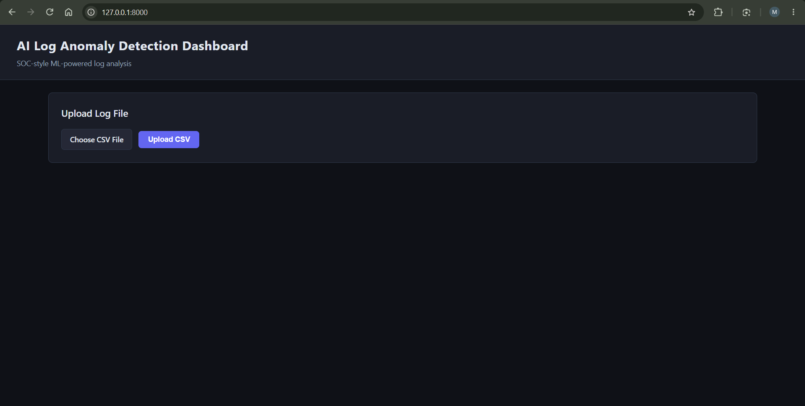
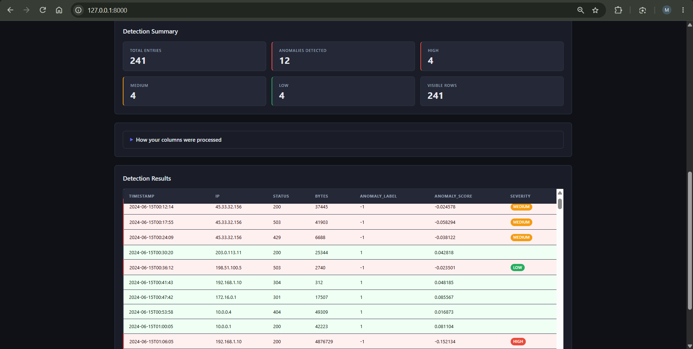

# SOC Log Anomaly Detector

SOC-inspired dashboard for unsupervised anomaly triage in tabular log data.

Upload a CSV, choose a contamination rate, and get back a color-coded table of flagged rows with severity labels, a summary of which columns were used and how, and a downloadable results file — all without writing a line of code.

---

## Features

| Feature | Detail |
|---|---|
| CSV upload with validation | Accepts files up to 50 MB and 500 000 rows; rejects wrong extensions and empty files with clear error messages |
| Automatic column-type detection | Detects IP addresses, datetimes, and plain categoricals; reports what it did in a "How your columns were processed" panel |
| Feature engineering | IPs → frequency; datetimes → hour-of-day, day-of-week, epoch seconds; other strings → frequency; empty, constant, and high-cardinality free-text columns dropped |
| IsolationForest detection | scikit-learn `IsolationForest`, fitted fresh on each request; no pre-trained model required |
| Adjustable contamination | Slider + number input, range 0.01–0.30, sent as a form field to the API |
| Relative severity ranking | Flagged rows split into thirds by anomaly score: bottom third → HIGH, middle → MEDIUM, top → LOW |
| Color-coded results table | Anomalous rows highlighted red; normal rows green; sticky header; badges for HIGH / MEDIUM / LOW |
| Anomaly-only filter | Toggle to hide normal rows client-side |
| CSV export | Downloads currently visible rows (filtered or full) with correct quoting |

---

## Use cases

- Quickly triage a CSV export from a SIEM, firewall, or web server before deeper investigation.
- Explore what "looks unusual" in a new dataset without writing preprocessing code.
- Demonstrate unsupervised anomaly detection concepts to a team or in a portfolio.

---

## How it works

```
Browser
  └─ POST /detect  (multipart/form-data: file + contamination)
        │
        ▼
  FastAPI  (backend/main.py)
        │
        ├─ Validate: size ≤ 50 MB, ≤ 500 000 rows, .csv extension
        │
        ├─ preprocess()  (backend/preprocess.py)
        │    ├── numeric dtype         → kept as-is
        │    ├── IP-like strings       → <col>_freq  (normalised frequency)
        │    ├── datetime-like strings → <col>_hour, <col>_dow, <col>_epoch
        │    ├── other strings         → <col>_freq
        │    ├── entirely null         → dropped, reported
        │    ├── constant (1 value)    → dropped, reported
        │    └── high-cardinality free text (unique ratio > 0.95) → dropped
        │
        ├─ IsolationForest.fit_predict()  (backend/model.py)
        │    contamination = user-supplied value, random_state = 42
        │
        ├─ assign_severities()  (backend/utils.py)
        │    splits flagged rows into thirds by anomaly score
        │
        └─ JSON response: original rows + anomaly_label, anomaly_score, severity
                          + feature_report (one entry per original column)

Browser
  └─ renderTable(), renderFeatureReport(), applyFilter(), downloadCSV()
     (frontend/static/script.js — vanilla JS, no framework)
```

---

## Evaluation on synthetic data

The file `data/sample_logs_labeled.csv` (241 rows, 39 planted anomalies, true anomaly rate 16.2%) was evaluated at four contamination values. Results were computed by `scripts/evaluate.py` using the exact same pipeline the API uses.

> **The dataset is fully synthetic.** Anomalies were planted deliberately to be detectable (high bytes, rare HTTP status codes, repeated source IP). These numbers measure the detector's ability to recover known signals, not its performance on real-world log data.

### Planted anomaly sub-types

| Type | Count | Signal |
|---|---|---|
| High bytes | 5 rows | `bytes` in \[500 001, 5 000 000\] |
| Rare status codes | 3 rows | `status` ∈ {500, 503, 429} |
| Repeated source IP | 31 rows | all from `45.33.32.156` |

### Contamination sweep

| Contamination | Rows flagged | Precision | Recall | F1 | FPR |
|:---:|:---:|:---:|:---:|:---:|:---:|
| 0.05 | 12 | 1.000 | 0.308 | 0.471 | 0.000 |
| 0.10 | 24 | 0.917 | 0.564 | 0.698 | 0.010 |
| 0.15 | 36 | 0.833 | 0.769 | 0.800 | 0.030 |
| 0.20 | 48 | 0.812 | 1.000 | 0.897 | 0.045 |

Recall at low contamination is mechanically capped: if the true anomaly rate is 16.2% but the model is only allowed to flag 5% of rows, it cannot return more than 12 positives regardless of how well it ranks them. Setting contamination close to the true anomaly rate is a necessary condition for high recall in this unsupervised setup. The optimal value is not knowable in advance on real data; it has to be chosen from domain knowledge or by reviewing flagged rows.

---

## Testing on other CSV schemas

`scripts/smoke_test_unseen.py` runs the full API against three synthetic CSVs that were not used to build the project:

| Schema | Columns | Planted anomalies | Caught at contamination 0.10 |
|---|---|---|---|
| Web access log | timestamp, host, method, path, status, bytes | high bytes, HTTP 500, TRACE method | 3 / 3 |
| Network flow | src\_ip, dst\_ip, port, protocol, duration, packets | huge packet count, rare port, unusual protocol | 3 / 3 |
| Numeric sensor | temp, pressure, humidity, voltage, current | extreme outlier on all 5 columns | 1 / 1 |

For the sensor outlier, the script also asserts that the planted row has the lowest anomaly score in the file.

These CSVs are synthetic and the anomalies were planted to be detectable. They do not constitute real-world validation.

---

## Quick start

**Requires Python 3.12**

```bash
# 1. Clone
git clone https://github.com/BhargavMalakonda/soc-log-anomaly-detector.git
cd soc-log-anomaly-detector

# 2. Create and activate a virtual environment
python -m venv .venv

# Windows
.venv\Scripts\activate
# macOS / Linux
source .venv/bin/activate

# 3. Install runtime dependencies
pip install -r requirements.txt

# 4. Start the server
uvicorn backend.main:app --reload
```

Open **http://127.0.0.1:8000** in your browser, then upload `data/sample_logs.csv` and click **Detect Anomalies**.

---

## Using your own CSV

Any tabular CSV with at least two columns that survive feature engineering (numeric, IP, or datetime) will work. There is no fixed schema requirement.

| Limit | Value |
|---|---|
| File size | 50 MB |
| Row count | 500 000 |
| Contamination | 0.01 – 0.30 |
| Encoding | UTF-8 recommended; other encodings may fail with a 422 error |
| Date format | ISO-8601 recommended; see Limitations for ambiguous formats |

---

## Running tests

```bash
pip install pytest httpx
pytest
```

---

## Tech stack

| Layer | Technology |
|---|---|
| Backend | FastAPI (Python) |
| ML | scikit-learn — IsolationForest |
| Frontend | HTML5 + CSS3 + Vanilla JS |
| Templates | Jinja2 (served by FastAPI) |
| Data | pandas + numpy |

---

## Limitations

- **CSV only.** Syslog, JSON logs, Windows Event XML, CEF, LEEF, and JSONL are not supported. The file must have a `.csv` extension and parse cleanly with `pandas.read_csv`.
- **Unsupervised quota.** The model flags roughly the contamination fraction of rows on every run, even on perfectly clean data. Setting contamination too high increases false positives; too low misses anomalies.
- **Relative severity, not calibrated risk.** HIGH / MEDIUM / LOW are the bottom, middle, and top thirds of the flagged set's score distribution. A HIGH row is only the worst among the rows the model chose to flag — it is not an absolute risk score.
- **Detection relies on numeric extremes and IP frequency.** High-bytes outliers were flagged at every contamination level tested. Repeated-IP rows were only partly caught at low contamination (see the sweep).
- **Ambiguous non-ISO dates.** Dates like `05/06/2024` are parsed month-first by `pandas` with `format="mixed"`, so June 5 and May 6 are indistinguishable. Use ISO-8601 (`2024-06-05T10:30:00`) to avoid ambiguity.
- **Unix epoch integers are treated as plain numbers.** A column of values like `1700000000` has `int64` dtype and goes through the numeric path, not the datetime path. The model sees the raw integer values rather than hour-of-day or day-of-week features.
- **Numeric identifier columns.** Columns such as `port` or `user_id` are kept as continuous numeric features. Port 31337 is an outlier relative to 80/443/22 by value, which can help detection, but the model has no knowledge that port numbers are categorical identifiers.
- **No authentication.** The API has no login, no API keys, and no rate limiting. It is intended for local use only.
- **No alert workflow or SIEM integration.** There is no alert queue, no webhook, no email or Slack notification, and no case management.
- **No persistence.** The model is fitted fresh on every request. There is no history, no trend detection across sessions, and no analyst feedback loop.
- **No feature-level explanations.** The response includes an anomaly score per row but does not indicate which column or feature drove the detection (no SHAP values or similar).

---

## Future work

- Log-format parsers for syslog, JSON, and CEF so raw log files can be uploaded directly.
- Feature-level explanations (SHAP-style) so analysts can see which column drove each detection.
- Analyst feedback loop: mark rows as true/false positives and retrain or reweight.
- SIEM webhook integration for forwarding flagged rows to an external alert platform.
- Docker image for one-command deployment.

---

## Screenshots

| | |
|---|---|
|  |  |
| File picker and upload button | Detection summary cards and color-coded results table |

---

## Author

**Malakonda Chaitanya Bhargav**
[LinkedIn](https://www.linkedin.com/in/chaitanya-bhargav-malakonda/)
